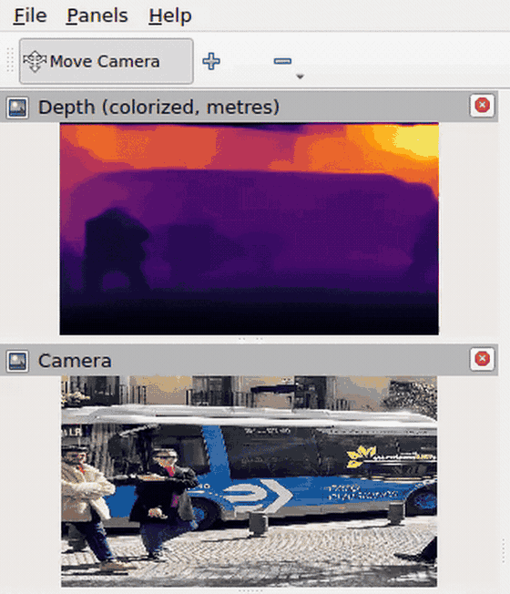

# ros2_yolos_trt

ROS 2 wrapper for [YOLOs-CPP-TensorRT](https://github.com/Geekgineer/YOLOs-CPP-TensorRT)
**v3.1.0** — six inference tasks as composable lifecycle nodes, running on TensorRT.

The TensorRT sibling of [ros2_yolos_cpp](https://github.com/Geekgineer/ros2_yolos_cpp),
which wraps the ONNX Runtime build of the same library.

## Monocular metric depth in RViz



The `yolos_trt_depth` node publishing per-pixel distance from a single RGB
camera, using the YOLO26-depth models introduced in v3.1.0. Left: the camera
stream. Right: the colorized depth map. Regenerate this recording with
`scripts/record_depth_demo.sh`.

Depth is published as `32FC1` in **metres** — the ROS convention — so it feeds
existing tooling unchanged:

```bash
ros2 run depth_image_proc point_cloud_xyz \
  --ros-args -r image_rect:=/yolos_trt_depth/depth/image
```

## Tasks

| Task | Executable | Publishes |
|------|-----------|-----------|
| Detection | `yolos_trt_detector_node` | `vision_msgs/Detection2DArray` |
| Segmentation | `yolos_trt_segmentor_node` | `Detection2DArray` + `mono8` label mask |
| Pose | `yolos_trt_pose_node` | `Detection2DArray` + `KeyPoint2DArray` |
| OBB | `yolos_trt_obb_node` | `OBBDetection2DArray` |
| Classification | `yolos_trt_classifier_node` | `vision_msgs/Classification` |
| Metric depth | `yolos_trt_depth_node` | `sensor_msgs/Image` `32FC1`, metres |

Every node also offers `~/debug_image` (annotated `bgr8`) and `~/timing`
(`[inference_ms, total_ms]`), both off by default.

## Requirements

- ROS 2 (Jazzy or Humble)
- NVIDIA GPU, compute capability >= 7.5
- CUDA Toolkit >= 12.0
- **TensorRT 10.x — not 11.x.** `libnvinfer-dev` now resolves to 11.x, which
  removed the tensor API this library uses. Pin the whole family:
  ```bash
  sudo tee /etc/apt/preferences.d/tensorrt-pin > /dev/null <<'PIN'
  Package: libnvinfer* libnvonnxparsers* tensorrt*
  Pin: version 10.*
  Pin-Priority: 1001
  PIN
  sudo apt-get update
  ```
  Pinning individual packages instead of the family fails on unmet
  dependencies. `libnvonnxparser-dev` is also required — it is what builds
  engines from ONNX.
- OpenCV >= 4.5

## Build

```bash
cd ~/ros2_ws/src
git clone https://github.com/Geekgineer/ros2_yolos_trt.git
cd ~/ros2_ws
colcon build --packages-select ros2_yolos_trt
```

The upstream library is fetched at the pinned `v3.1.0` tag during configure, so
there is no separate install step. The package compiles upstream's one CUDA
translation unit itself, which is why it enables the CUDA language.

CUDA architectures default to `75;80;86;89;90` (`72;87` on Jetson) and are
**not** auto-detected. Narrowing them to your own GPU cuts compile time
substantially:

```bash
colcon build --packages-select ros2_yolos_trt \
  --cmake-args -DCMAKE_CUDA_ARCHITECTURES=89
```

## Models

`model_path` accepts either form:

- **`.onnx`** — an engine is built on first `configure` and cached beside the
  model. The right choice when one model ships to a fleet of mixed GPUs,
  because a TensorRT engine is portable across neither GPU architecture nor
  TensorRT version.
- **`.trt` / `.engine`** — loaded directly, for fast deterministic startup.

The cache key covers compute capability, TensorRT version, precision, DLA core,
and the model's size and mtime, so a changed model or a different machine
rebuilds rather than silently running the wrong network. Engines are written to
a `.partial` file and renamed, so an interrupted build cannot leave a truncated
file that later reads as a cache hit.

Export a depth model at its training resolution:

```bash
python -c "from ultralytics import YOLO; \
  YOLO('yolo26n-depth.pt').export(format='onnx', imgsz=768, opset=12, simplify=True)"
```

## Run

```bash
ros2 launch ros2_yolos_trt depth.launch.py \
  model_path:=/models/yolo26n-depth.onnx \
  image_topic:=/camera/image_raw

# nodes are managed; the first configure builds the engine
ros2 lifecycle set /yolos_trt_depth configure
ros2 lifecycle set /yolos_trt_depth activate
```

Every task follows the same shape — `detector.launch.py`, `segmentor.launch.py`,
`pose.launch.py`, `obb.launch.py`, `classifier.launch.py`, `depth.launch.py`.

## Parameters

| Parameter | Default | Notes |
|-----------|---------|-------|
| `model_path` | *(required)* | `.onnx`, `.trt` or `.engine` |
| `labels_path` | `""` | not used by depth |
| `precision` | `fp16` | `fp32` or `fp16`; used only when building |
| `engine_cache_dir` | `""` | default: beside the model |
| `dla_core` | `-1` | `-1` = GPU, `0`/`1` = DLA on Jetson |
| `conf_threshold` | `0.4` | |
| `nms_threshold` | `0.45` | |
| `max_detections` | `300` | OBB only |
| `depth_min` / `depth_max` | `0.0` | debug colorization clamp, metres; `0` = auto |
| `publish_debug_image` | `false` | |
| `publish_timing` | `false` | `[inference_ms, total_ms]` |

There is deliberately no `use_gpu` (TensorRT is always GPU) and no
`yolo_version` (the library detects it from output tensor shapes). Both exist in
the ONNX package and would do nothing here.

## Differences from ros2_yolos_cpp

Same layering — lifecycle nodes → pimpl adapters → converters — so the two
packages navigate the same way. Three deliberate departures:

1. **Pose publishes keypoints.** The ONNX package ships `KeyPoint2D.msg` and
   forward-declares the converter, but never implements or publishes it, and
   `Detection2DArray` has no keypoint field — so keypoints were computed and
   discarded. Here they go out on `~/keypoints`.
2. **Depth exists**, publishing metres as `32FC1`.
3. **TensorRT-shaped parameters**: `precision`, `engine_cache_dir`, `dla_core`
   replace `use_gpu` and `yolo_version`.

## Testing

```bash
colcon test --packages-select ros2_yolos_trt   # unit tests, no GPU needed
```

Integration tests skip unless pointed at models:

```bash
export YOLOS_TRT_DEPTH_MODEL=/models/yolo26n-depth.onnx
export YOLOS_TRT_TEST_IMAGE=/models/bus.jpg
colcon test --packages-select ros2_yolos_trt --ctest-args -R test_integration_depth
```

## Troubleshooting

**Results look plausible but are wrong.** Check the CUDA architecture the build
actually used:

```bash
grep CMAKE_CUDA_ARCHITECTURES build/ros2_yolos_trt/CMakeCache.txt
```

`52` means the CUDA preprocessing kernel was built for sm_52 and returns
incorrect pixels on a modern GPU — plausible-looking but wrong output, with no
error anywhere. Reconfigure from a clean build directory. The build hard-fails
on `52` to make this unmissable.

**`configure` hangs for minutes.** Expected on the first run with a `.onnx`:
the engine is being built. Subsequent runs hit the cache.

**`configure` returns FAILURE.** The node logs why — a missing model, an engine
built for a different GPU, or a TensorRT version mismatch.

**Build fails with a TensorRT version error.** You have 11.x. Apply the apt pin
above and reconfigure.

## License

AGPL-3.0, matching the upstream library.
