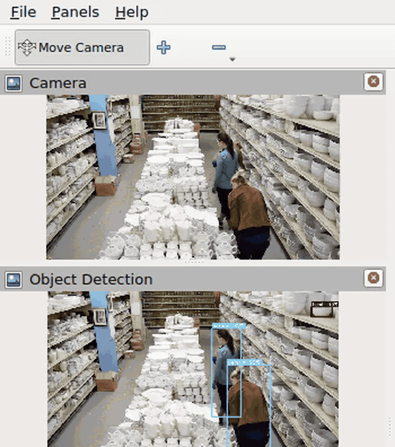
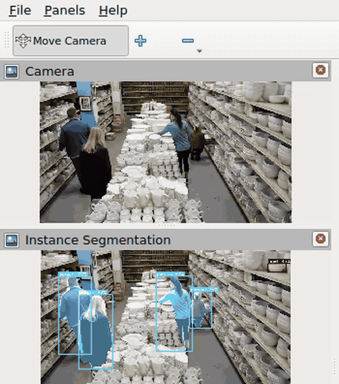
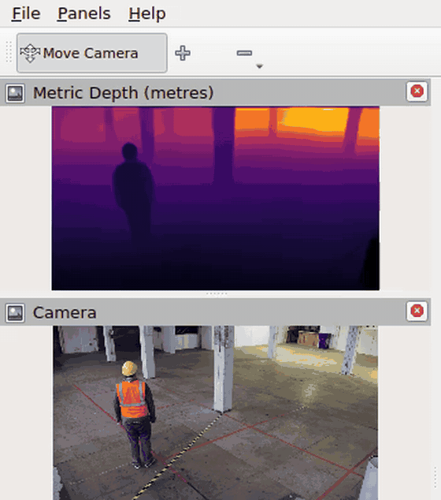

<div align="center">


<h1>ROS 2 YOLOs-TRT</h1>
<h3>TensorRT-Native YOLO Inference for ROS 2</h3>

**Six YOLO tasks as composable lifecycle nodes, on a zero-copy GPU pipeline.**

Detection · Segmentation · Pose · OBB · Classification · **Monocular Metric Depth**

<br/>

[](https://github.com/Geekgineer/ros2_yolos_trt/actions)
[](LICENSE)
[](https://docs.ros.org)
[](https://developer.nvidia.com/tensorrt)
[](https://developer.nvidia.com/cuda-toolkit)
[](https://en.cppreference.com/w/cpp/17)

<br/>

[**Demos**](#-demos) · [**Benchmarks**](#-benchmarks) · [**Quick Start**](#-quick-start) · [**Models**](#-models) · [**Parameters**](#%EF%B8%8F-parameters) · [**Testing**](#-testing)

</div>

---

## 🎬 Demos

Every clip below is a live `rviz2` capture on an **RTX 4090**, running real video
through the node — annotated output on top, source camera underneath.
Reproduce any of them with `scripts/record_demo.sh <task> <model> <video>`.

<table align="center" cellpadding="8">
  <tr>
    <td align="center"><b>Object Detection</b><br/><sub>yolo11n · 640</sub><br/>
      </td>
    <td align="center"><b>Instance Segmentation</b><br/><sub>yolo11n-seg · 640</sub><br/>
      </td>
  </tr>
  <tr>
    <td align="center"><b>Pose Estimation</b><br/><sub>yolo11n-pose · 640</sub><br/>
      </td>
    <td align="center"><b>Monocular Metric Depth</b><br/><sub>yolo26n-depth · 768</sub><br/>
      </td>
  </tr>
</table>

Depth is the capability this package adds over its ONNX sibling. It publishes
`32FC1` in **metres** — the ROS convention — so it drops into existing tooling
unchanged:

```bash
ros2 run depth_image_proc point_cloud_xyz \
  --ros-args -r image_rect:=/yolos_trt_depth/depth/image
```

---

## 📊 Benchmarks

<!-- BENCHMARK_TABLE -->

---

## ✨ Key Features

- **⚡ GPU preprocessing** — letterbox, BGR→RGB and normalize in a single CUDA
  kernel writing straight into the TensorRT input buffer. The CPU never touches
  a pixel after `cv_bridge`.
- **🎯 CUDA graph replay** — inference dispatch is captured once and replayed,
  removing per-frame launch overhead.
- **🔄 Lifecycle managed** — full `configure` / `activate` / `deactivate` /
  `cleanup`. Engine building happens in `on_configure`, so a node that cannot
  load its model reports `FAILURE` instead of coming up broken.
- **🧩 Composable** — every task is an `rclcpp_components` plugin; run several
  in one container.
- **📦 Point it at an `.onnx`** — the engine is built on first configure and
  cached, keyed on GPU architecture, TensorRT version and precision. One model
  file ships to a fleet of mixed GPUs.
- **🔌 Standard messages** — `vision_msgs` throughout, plus package-local
  messages for oriented boxes and keypoints, which `vision_msgs` has no type for.
- **🛡️ Loose coupling** — nodes depend on abstract adapters, never on `yolos::`
  types. An upstream version bump touches only adapter internals.

---

## 🧩 Tasks

| Task | Executable | Publishes |
|------|-----------|-----------|
| Detection | `yolos_trt_detector_node` | `vision_msgs/Detection2DArray` |
| Segmentation | `yolos_trt_segmentor_node` | `Detection2DArray` + `mono8` label mask |
| Pose | `yolos_trt_pose_node` | `Detection2DArray` + `KeyPoint2DArray` |
| OBB | `yolos_trt_obb_node` | `OBBDetection2DArray` |
| Classification | `yolos_trt_classifier_node` | `vision_msgs/Classification` |
| **Metric depth** | `yolos_trt_depth_node` | `sensor_msgs/Image` — `32FC1`, metres |

Every node also offers `~/debug_image` (annotated `bgr8`) and `~/timing`
(`[inference_ms, total_ms]`), both off by default.

---

## 🚀 Quick Start

```bash
# 1. Build
mkdir -p ~/ros2_ws/src && cd ~/ros2_ws/src
git clone https://github.com/Geekgineer/ros2_yolos_trt.git
cd ~/ros2_ws && colcon build --packages-select ros2_yolos_trt
source install/setup.bash

# 2. Export a model
python -c "from ultralytics import YOLO; \
  YOLO('yolo26n-depth.pt').export(format='onnx', imgsz=768, opset=12, simplify=True)"

# 3. Run — the first configure builds and caches the TensorRT engine
ros2 launch ros2_yolos_trt depth.launch.py \
  model_path:=$PWD/yolo26n-depth.onnx image_topic:=/camera/image_raw
ros2 lifecycle set /yolos_trt_depth configure
ros2 lifecycle set /yolos_trt_depth activate
```

Every task follows the same shape — `detector.launch.py`, `segmentor.launch.py`,
`pose.launch.py`, `obb.launch.py`, `classifier.launch.py`, `depth.launch.py`.

---

## 📥 Installation

### Prerequisites

| Dependency | Version | Notes |
|------------|---------|-------|
| ROS 2 | Humble or Jazzy | |
| NVIDIA GPU | CC ≥ 7.5 | Turing → Hopper, or Jetson Xavier/Orin |
| CUDA Toolkit | ≥ 12.0 | |
| **TensorRT** | **10.x — not 11.x** | 11.x removed the tensor API this library uses |
| OpenCV | ≥ 4.5 | |

> **Pin TensorRT.** `apt-get install libnvinfer-dev` now resolves to TensorRT
> 11.x built against CUDA 13, which will not compile. Pin the whole family —
> pinning individual packages fails on unmet dependencies:
>
> ```bash
> sudo tee /etc/apt/preferences.d/tensorrt-pin > /dev/null <<'PIN'
> Package: libnvinfer* libnvonnxparsers* tensorrt*
> Pin: version 10.*
> Pin-Priority: 1001
> PIN
> sudo apt-get update
> sudo apt-get install -y libnvinfer-dev libnvinfer-headers-dev libnvonnxparsers-dev
> ```
>
> `libnvonnxparser-dev` is required — it is what builds engines from ONNX.

### Build

```bash
cd ~/ros2_ws
rosdep install --from-paths src --ignore-src -y
colcon build --packages-select ros2_yolos_trt --cmake-args -DCMAKE_BUILD_TYPE=Release
```

[YOLOs-CPP-TensorRT](https://github.com/Geekgineer/YOLOs-CPP-TensorRT) is fetched
at the pinned **v3.1.0** tag during configure — no separate install step. The
package compiles upstream's one CUDA translation unit itself, which is why it
enables the CUDA language.

CUDA architectures default to `75;80;86;89;90` (`72;87` on Jetson) and are
**not** auto-detected. Narrowing them to your own GPU cuts compile time a lot:

```bash
colcon build --packages-select ros2_yolos_trt \
  --cmake-args -DCMAKE_CUDA_ARCHITECTURES=89
```

---

## 🧠 Models

`model_path` accepts either form:

| Form | Behaviour | When to use |
|------|-----------|-------------|
| `.onnx` | Engine built on first `configure`, then cached | One model across a fleet of mixed GPUs |
| `.trt` / `.engine` | Loaded directly | Fast, deterministic startup |

A TensorRT engine is portable across neither GPU architecture nor TensorRT
version, so the cache key covers compute capability, TensorRT version,
precision, DLA core, and the model's size and mtime. A changed model or a
different machine rebuilds rather than silently running the wrong network.
Engines are written to a `.partial` file and renamed, so an interrupted build
cannot leave a truncated file that later reads as a cache hit.

```bash
# Export at the resolution the weights were trained for
python -c "from ultralytics import YOLO; YOLO('yolo11n.pt').export(format='onnx', imgsz=640, opset=12, simplify=True)"
python -c "from ultralytics import YOLO; YOLO('yolo26n-depth.pt').export(format='onnx', imgsz=768, opset=12, simplify=True)"
```

---

## ⚙️ Parameters

| Parameter | Default | Notes |
|-----------|---------|-------|
| `model_path` | *(required)* | `.onnx`, `.trt` or `.engine` |
| `labels_path` | `""` | not used by depth |
| `precision` | `fp16` | `fp32` or `fp16`; used only when building |
| `engine_cache_dir` | `""` | default: beside the model |
| `dla_core` | `-1` | `-1` = GPU, `0`/`1` = DLA on Jetson |
| `conf_threshold` | `0.4` | |
| `nms_threshold` | `0.45` | |
| `max_detections` | `300` | OBB only |
| `depth_min` / `depth_max` | `0.0` | debug colorization clamp, metres; `0` = auto |
| `publish_debug_image` | `false` | annotated `bgr8` on `~/debug_image` |
| `publish_timing` | `false` | `[inference_ms, total_ms]` on `~/timing` |

There is deliberately no `use_gpu` (TensorRT is always GPU) and no
`yolo_version` (the library detects it from output tensor shapes). Both exist in
the ONNX package and would do nothing here.

---

## 🔬 Differences from ros2_yolos_cpp

Same layering — lifecycle nodes → pimpl adapters → converters — so the two
packages navigate the same way. Three deliberate departures:

1. **Pose publishes keypoints.** The ONNX package ships `KeyPoint2D.msg` and
   forward-declares the converter, but never implements or publishes it, and
   `Detection2DArray` has no keypoint field — so keypoints were computed and
   discarded. Here they go out on `~/keypoints`.
2. **Depth exists**, publishing metres as `32FC1`.
3. **TensorRT-shaped parameters**: `precision`, `engine_cache_dir` and
   `dla_core` replace `use_gpu` and `yolo_version`.

---

## 🧪 Testing

```bash
colcon test --packages-select ros2_yolos_trt   # unit tests, no GPU needed
colcon test-result --verbose
```

51 unit tests cover the six message converters, the DTO contracts, the engine
cache key and the lifecycle parameter surface. Integration tests skip
themselves unless pointed at models:

```bash
export YOLOS_TRT_DEPTH_MODEL=/models/yolo26n-depth.onnx
export YOLOS_TRT_TEST_IMAGE=/models/bus.jpg
colcon test --packages-select ros2_yolos_trt --ctest-args -R test_integration_depth
```

Reproduce the benchmark table with:

```bash
./scripts/run_benchmarks.sh /models /path/to/video.mp4 300
```

---

## 🩺 Troubleshooting

<details>
<summary><b>Results look plausible but are wrong</b></summary>

Check which CUDA architecture the build actually used:

```bash
grep CMAKE_CUDA_ARCHITECTURES build/ros2_yolos_trt/CMakeCache.txt
```

`52` means the CUDA preprocessing kernel was built for sm_52 and returns
incorrect pixels on a modern GPU — plausible-looking but wrong output, with no
error anywhere. Reconfigure from a clean build directory. The build hard-fails
on `52` to make this unmissable.
</details>

<details>
<summary><b>configure hangs for minutes</b></summary>

Expected on the first run with a `.onnx`: the engine is being built. Watch for
`[engine_cache] building engine`. Subsequent runs log `cache hit` and start in
milliseconds.
</details>

<details>
<summary><b>configure returns FAILURE</b></summary>

The node logs the reason — a missing model, an engine built for a different
GPU, or a TensorRT version mismatch.
</details>

<details>
<summary><b>Build fails with a TensorRT version error</b></summary>

You have 11.x. Apply the apt pin above and reconfigure from a clean build
directory.
</details>

<details>
<summary><b>Recording a demo: Xvfb segfaults</b></summary>

On a GPU container, glvnd offers NVIDIA's EGL vendor to Xvfb, which then
crashes during GLX init. `scripts/record_demo.sh` restricts the vendor list to
Mesa and forces llvmpipe, which is what a headless capture wants anyway.
</details>

---

## 📄 License

AGPL-3.0, matching the upstream library.

<div align="center">
<sub>Built on <a href="https://github.com/Geekgineer/YOLOs-CPP-TensorRT">YOLOs-CPP-TensorRT</a> · sibling of <a href="https://github.com/Geekgineer/ros2_yolos_cpp">ros2_yolos_cpp</a></sub>
</div>
