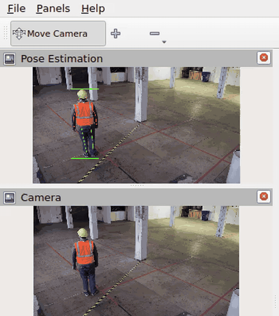

<div align="center">


<br/>

# ROS 2 YOLOs-TRT

**TensorRT-native YOLO inference for ROS 2.**

Six tasks as composable lifecycle nodes on a zero-copy GPU pipeline.

Detection · Segmentation · Pose · OBB · Classification · **Monocular Metric Depth**

<br/>

[](https://github.com/Geekgineer/ros2_yolos_trt/actions)
[](LICENSE)
[](https://docs.ros.org)
[](https://developer.nvidia.com/tensorrt)
[](https://developer.nvidia.com/cuda-toolkit)
[](https://en.cppreference.com/w/cpp/17)
[](https://github.com/Geekgineer/ros2_yolos_trt/stargazers)

<br/>

[**Demos**](#-demos) ·
[**Benchmarks**](#-benchmarks) ·
[**Quick Start**](#-quick-start) ·
[**Installation**](#-installation) ·
[**Models**](#-models) ·
[**Parameters**](#%EF%B8%8F-parameters) ·
[**Architecture**](#%EF%B8%8F-architecture) ·
[**Testing**](#-testing) ·
[**Troubleshooting**](#-troubleshooting)

</div>

---

## 🎬 Demos

Every clip below is a live `rviz2` capture on an **RTX 4090**, running real video
through the node — annotated output on one panel, the source camera on the other.
Reproduce any of them with `scripts/record_demo.sh <task> <model> <video>`.

Footage from the [Intel IoT sample videos](https://github.com/intel-iot-devkit/sample-videos)
collection (retail aisle and worker-zone scenes).

<table align="center" cellpadding="8">
  <tr>
    <td align="center"><b>Object Detection</b><br/><sub>yolo11n · 640</sub><br/>
      </td>
    <td align="center"><b>Instance Segmentation</b><br/><sub>yolo11n-seg · 640</sub><br/>
      </td>
  </tr>
  <tr>
    <td align="center"><b>Pose Estimation</b><br/><sub>yolo11n-pose · 640</sub><br/>
      </td>
    <td align="center"><b>Monocular Metric Depth</b><br/><sub>yolo26n-depth · 768</sub><br/>
      </td>
  </tr>
</table>

Depth is the capability this package adds over its ONNX sibling. It publishes
`32FC1` in **metres** — the ROS convention — so it drops into existing tooling
unchanged:

```bash
ros2 run depth_image_proc point_cloud_xyz \
  --ros-args -r image_rect:=/yolos_trt_depth/depth/image
```

---

## ✨ Highlights

<div align="center">

| Aspect | How it works |
|:---|:---|
| **Preprocessing** | Letterbox, BGR→RGB and normalize in **one CUDA kernel**, writing straight into the TensorRT input buffer. The CPU never touches a pixel after `cv_bridge`. |
| **Inference dispatch** | **CUDA graph replay** — captured once, replayed per frame, no launch overhead. |
| **Node lifecycle** | Full `configure` / `activate` / `deactivate` / `cleanup`. Engines are built in `on_configure`, so a node that cannot load its model reports `FAILURE` instead of coming up broken. |
| **Deployment** | Point it at an `.onnx`. The engine is built on first configure and **cached**, keyed on GPU architecture, TensorRT version and precision — one model file ships to a fleet of mixed GPUs. |
| **Composition** | Every task is an `rclcpp_components` plugin; run several in one container. |
| **Messages** | `vision_msgs` throughout, plus package-local types for oriented boxes and keypoints, which `vision_msgs` has no type for. |
| **Coupling** | Nodes depend on abstract adapters, never on `yolos::` types. An upstream version bump touches only adapter internals. |

</div>

---

## 🧩 Tasks

<div align="center">

| Task | Executable | Publishes |
|:-----|:-----------|:----------|
| Detection | `yolos_trt_detector_node` | `vision_msgs/Detection2DArray` |
| Segmentation | `yolos_trt_segmentor_node` | `Detection2DArray` + `mono8` label mask |
| Pose | `yolos_trt_pose_node` | `Detection2DArray` + `KeyPoint2DArray` |
| OBB | `yolos_trt_obb_node` | `OBBDetection2DArray` |
| Classification | `yolos_trt_classifier_node` | `vision_msgs/Classification` |
| **Metric depth** | `yolos_trt_depth_node` | `sensor_msgs/Image` — `32FC1`, metres |

</div>

Every node also offers `~/debug_image` (annotated `bgr8`) and `~/timing`
(`[inference_ms, total_ms]`), both off by default.

---

## 📊 Benchmarks

<!-- BENCHMARK_TABLE -->
Measured on **NVIDIA RTX 4090** · TensorRT 10.16 · ROS 2 Jazzy, fp16 engines.

Latency is reported by the nodes themselves on `~/timing`, so it covers
inference plus message conversion — not DDS transport or subscriber
scheduling. The first samples are discarded while the CUDA graph and
allocator settle.

| Task | Model | Mean | p50 | p95 | p99 | Inference FPS |
|------|-------|-----:|----:|----:|----:|--------------:|
| Detection | `yolo11n.onnx` | 2.782 ms | 2.873 ms | 3.453 ms | 3.932 ms | **359.5** |
| Segmentation | `yolo11n-seg.onnx` | 10.393 ms | 5.718 ms | 49.208 ms | 63.443 ms | **96.2** |
| Pose | `yolo11n-pose.onnx` | 0.946 ms | 0.945 ms | 0.988 ms | 1.011 ms | **1056.7** |
| Depth | `yolo26n-depth.onnx` | 2.251 ms | 1.752 ms | 2.0 ms | 24.374 ms | **444.3** |

> `Inference FPS` is `1000 / mean`, i.e. the rate one node sustains on one
> GPU with nothing else running. Achieved publish rate is bounded by the
> input frame rate, so it is not a model-capacity figure.

Reproduce with:

```bash
./scripts/run_benchmarks.sh /path/to/models /path/to/video.mp4 250
```
<!-- /BENCHMARK_TABLE -->

<details>
<summary><b>Why segmentation has a wide tail</b></summary>

<br/>

Detection, pose and depth hold a tight distribution — p99 within ~15% of the
median. Segmentation does not, and the reason is structural rather than noise:
mask postprocessing combines 32 prototype masks per instance, applies a sigmoid
and resizes to the source resolution, all on the CPU. Cost therefore scales with
the number of detected instances, and the benchmark clip is a busy shop aisle.

On sparser scenes segmentation tracks its median closely. If you need a flat tail
with many instances, that postprocessing is the thing to move onto the GPU.

</details>

---

## 🚀 Quick Start

**Three steps to a running node:**

```bash
# 1. Build
mkdir -p ~/ros2_ws/src && cd ~/ros2_ws/src
git clone https://github.com/Geekgineer/ros2_yolos_trt.git
cd ~/ros2_ws && colcon build --packages-select ros2_yolos_trt
source install/setup.bash

# 2. Export a model
python -c "from ultralytics import YOLO; \
  YOLO('yolo26n-depth.pt').export(format='onnx', imgsz=768, opset=12, simplify=True)"

# 3. Run — the first configure builds and caches the TensorRT engine
ros2 launch ros2_yolos_trt depth.launch.py \
  model_path:=$PWD/yolo26n-depth.onnx image_topic:=/camera/image_raw
ros2 lifecycle set /yolos_trt_depth configure
ros2 lifecycle set /yolos_trt_depth activate
```

Every task follows the same shape — `detector.launch.py`, `segmentor.launch.py`,
`pose.launch.py`, `obb.launch.py`, `classifier.launch.py`, `depth.launch.py`.

---

## 📥 Installation

### Prerequisites

<div align="center">

| Dependency | Version | Notes |
|:-----------|:-------:|:------|
| ROS 2 | Humble or Jazzy | |
| NVIDIA GPU | CC ≥ 7.5 | Turing → Hopper, or Jetson Xavier/Orin |
| CUDA Toolkit | ≥ 12.0 | |
| **TensorRT** | **10.x — not 11.x** | 11.x removed the tensor API this library uses |
| OpenCV | ≥ 4.5 | |

</div>

> **Pin TensorRT.** `apt-get install libnvinfer-dev` now resolves to TensorRT
> 11.x built against CUDA 13, which will not compile. Pin the whole family —
> pinning individual packages fails on unmet dependencies:
>
> ```bash
> sudo tee /etc/apt/preferences.d/tensorrt-pin > /dev/null <<'PIN'
> Package: libnvinfer* libnvonnxparsers* tensorrt*
> Pin: version 10.*
> Pin-Priority: 1001
> PIN
> sudo apt-get update
> sudo apt-get install -y libnvinfer-dev libnvinfer-headers-dev libnvonnxparsers-dev
> ```
>
> `libnvonnxparser-dev` is required — it is what builds engines from ONNX.

### Build

```bash
cd ~/ros2_ws
rosdep install --from-paths src --ignore-src -y
colcon build --packages-select ros2_yolos_trt --cmake-args -DCMAKE_BUILD_TYPE=Release
```

[YOLOs-CPP-TensorRT](https://github.com/Geekgineer/YOLOs-CPP-TensorRT) is fetched
at the pinned **v3.1.0** tag during configure — no separate install step. The
package compiles upstream's one CUDA translation unit itself, which is why it
enables the CUDA language.

CUDA architectures default to `75;80;86;89;90` (`72;87` on Jetson) and are
**not** auto-detected. Narrowing them to your own GPU cuts compile time a lot:

```bash
colcon build --packages-select ros2_yolos_trt \
  --cmake-args -DCMAKE_CUDA_ARCHITECTURES=89
```

---

## 🧠 Models

`model_path` accepts either form:

<div align="center">

| Form | Behaviour | When to use |
|:-----|:----------|:------------|
| `.onnx` | Engine built on first `configure`, then cached | One model across a fleet of mixed GPUs |
| `.trt` / `.engine` | Loaded directly | Fast, deterministic startup |

</div>

A TensorRT engine is portable across neither GPU architecture nor TensorRT
version, so the cache key covers compute capability, TensorRT version,
precision, DLA core, and the model's size and mtime. A changed model or a
different machine rebuilds rather than silently running the wrong network.
Engines are written to a `.partial` file and renamed, so an interrupted build
cannot leave a truncated file that later reads as a cache hit.

```bash
# Export at the resolution the weights were trained for
python -c "from ultralytics import YOLO; YOLO('yolo11n.pt').export(format='onnx', imgsz=640, opset=12, simplify=True)"
python -c "from ultralytics import YOLO; YOLO('yolo26n-depth.pt').export(format='onnx', imgsz=768, opset=12, simplify=True)"
```

---

## ⚙️ Parameters

<div align="center">

| Parameter | Default | Notes |
|:----------|:-------:|:------|
| `model_path` | *(required)* | `.onnx`, `.trt` or `.engine` |
| `labels_path` | `""` | not used by depth |
| `precision` | `fp16` | `fp32` or `fp16`; used only when building |
| `engine_cache_dir` | `""` | default: beside the model |
| `dla_core` | `-1` | `-1` = GPU, `0`/`1` = DLA on Jetson |
| `conf_threshold` | `0.4` | |
| `nms_threshold` | `0.45` | |
| `max_detections` | `300` | OBB only |
| `depth_min` / `depth_max` | `0.0` | debug colorization clamp, metres; `0` = auto |
| `publish_debug_image` | `false` | annotated `bgr8` on `~/debug_image` |
| `publish_timing` | `false` | `[inference_ms, total_ms]` on `~/timing` |

</div>

There is deliberately no `use_gpu` (TensorRT is always GPU) and no
`yolo_version` (the library detects it from output tensor shapes). Both exist in
the ONNX package and would do nothing here.

---

## 🏗️ Architecture

```
/camera/image_raw  (sensor_msgs/Image)
   │
   │  cv_bridge → cv::Mat (BGR, host)     ← last time the CPU sees a pixel
   ▼
Pinned staging buffer ──cudaMemcpyAsync──► Device uint8 (raw BGR)
                                                │
                                    ┌───────────┘
                                    ▼
                        letterboxNormalizeKernel()      ← one CUDA kernel
                        ┌──────────────────────────┐
                        │  bilinear letterbox       │
                        │  BGR → RGB               │
                        │  ÷ 255.0 normalize        │
                        │  HWC → NCHW transpose     │
                        └────────────┬─────────────┘
                                     ▼
                        TRT input buffer (float32, device)
                                     │
                          cudaGraphLaunch() / enqueueV3()
                                     ▼
                        TRT output buffer(s) (device)
                                     │
                              cudaMemcpyAsync D→H
                                     ▼
                        Task postprocess (NMS, masks, keypoints)
                                     │
                                     ▼
                        Converter → vision_msgs / sensor_msgs
                                     │
                                     ▼
                        Publishers: ~/detections · ~/masks · ~/keypoints
                                    ~/depth/image · ~/debug_image · ~/timing
```

Four layers, each replaceable without touching the others:

<div align="center">

| Layer | Location | Role |
|:------|:---------|:-----|
| **Lifecycle nodes** | `src/nodes/` | Parameters, publishers, lifecycle transitions. Know nothing about TensorRT. |
| **Adapters** | `src/adapters/` | Pimpl wrappers over `yolos::` task classes, exposing package-local DTOs. The only code that includes upstream headers. |
| **Converters** | `src/conversion/` | DTO → ROS message. Pure functions, fully unit-tested without a GPU. |
| **Engine cache** | `src/engine/` | ONNX → engine build, cache key, atomic write. |

</div>

<details>
<summary><b>Project layout</b></summary>

<br/>

```
ros2_yolos_trt/
├── include/ros2_yolos_trt/
│   ├── nodes/                 # Six lifecycle nodes + shared base
│   ├── adapters/              # Abstract adapters over the upstream library
│   ├── conversion/            # DTO → ROS message converters
│   └── engine/                # engine_cache.hpp
├── src/                       # Implementations mirroring include/
├── msg/                       # OBBDetection2D{,Array}, KeyPoint2D{,Array},
│                              #   OrientedBoundingBox2D
├── launch/                    # One launch file per task
├── config/default_params.yaml
├── rviz/demo.rviz.in          # Template used by the demo recorder
├── scripts/
│   ├── run_benchmarks.sh      #   Benchmark sweep → benchmarks/results.json
│   ├── benchmark_task.py      #   Single-task latency sampler
│   ├── record_demo.sh         #   Headless rviz2 capture → assets/*.gif
│   ├── record_depth_demo.sh
│   └── update_readme_benchmarks.py  # Splices results into this README
├── benchmarks/                # Recorded results (JSON + markdown)
├── test/unit/                 # Converters, DTOs, cache key, lifecycle — no GPU
├── test/integration/          # Per-task, skipped unless pointed at models
└── CMakeLists.txt             # Fetches upstream v3.1.0, enables CUDA
```

</details>

---

## 🔬 Differences from ros2_yolos_cpp

Same layering — lifecycle nodes → pimpl adapters → converters — so the two
packages navigate the same way. Three deliberate departures:

1. **Pose publishes keypoints.** The ONNX package ships `KeyPoint2D.msg` and
   forward-declares the converter, but never implements or publishes it, and
   `Detection2DArray` has no keypoint field — so keypoints were computed and
   discarded. Here they go out on `~/keypoints`.
2. **Depth exists**, publishing metres as `32FC1`.
3. **TensorRT-shaped parameters**: `precision`, `engine_cache_dir` and
   `dla_core` replace `use_gpu` and `yolo_version`.

---

## 🧪 Testing

```bash
colcon test --packages-select ros2_yolos_trt   # unit tests, no GPU needed
colcon test-result --verbose
```

51 unit tests cover the six message converters, the DTO contracts, the engine
cache key and the lifecycle parameter surface. Integration tests skip
themselves unless pointed at models:

```bash
export YOLOS_TRT_DEPTH_MODEL=/models/yolo26n-depth.onnx
export YOLOS_TRT_TEST_IMAGE=/models/bus.jpg
colcon test --packages-select ros2_yolos_trt --ctest-args -R test_integration_depth
```

Reproduce the benchmark table with:

```bash
./scripts/run_benchmarks.sh /models /path/to/video.mp4 300
```

---

## 🩺 Troubleshooting

<details>
<summary><b>Results look plausible but are wrong</b></summary>

<br/>

Check which CUDA architecture the build actually used:

```bash
grep CMAKE_CUDA_ARCHITECTURES build/ros2_yolos_trt/CMakeCache.txt
```

`52` means the CUDA preprocessing kernel was built for sm_52 and returns
incorrect pixels on a modern GPU — plausible-looking but wrong output, with no
error anywhere. Reconfigure from a clean build directory. The build hard-fails
on `52` to make this unmissable.

</details>

<details>
<summary><b>configure hangs for minutes</b></summary>

<br/>

Expected on the first run with a `.onnx`: the engine is being built. Watch for
`[engine_cache] building engine`. Subsequent runs log `cache hit` and start in
milliseconds.

</details>

<details>
<summary><b>configure returns FAILURE</b></summary>

<br/>

The node logs the reason — a missing model, an engine built for a different
GPU, or a TensorRT version mismatch.

</details>

<details>
<summary><b>Build fails with a TensorRT version error</b></summary>

<br/>

You have 11.x. Apply the apt pin above and reconfigure from a clean build
directory.

</details>

<details>
<summary><b>Recording a demo: Xvfb segfaults</b></summary>

<br/>

On a GPU container, glvnd offers NVIDIA's EGL vendor to Xvfb, which then
crashes during GLX init. `scripts/record_demo.sh` restricts the vendor list to
Mesa and forces llvmpipe, which is what a headless capture wants anyway.

</details>

---

## 🤝 Contributing

Issues and pull requests are welcome.

1. Fork the repository
2. Create a feature branch (`git checkout -b feature/amazing-feature`)
3. Keep `colcon test --packages-select ros2_yolos_trt` green
4. Push the branch and open a pull request

---

## 📄 License

**GNU Affero General Public License v3.0 (AGPL-3.0)** — matching the upstream
library. See [LICENSE](LICENSE).

---

<div align="center">

**Built on [YOLOs-CPP-TensorRT](https://github.com/Geekgineer/YOLOs-CPP-TensorRT)
with [NVIDIA TensorRT](https://developer.nvidia.com/tensorrt) and
[Ultralytics YOLO](https://github.com/ultralytics/ultralytics)**

<sub>Sibling of <a href="https://github.com/Geekgineer/ros2_yolos_cpp">ros2_yolos_cpp</a> — the ONNX Runtime edition.</sub>

</div>
